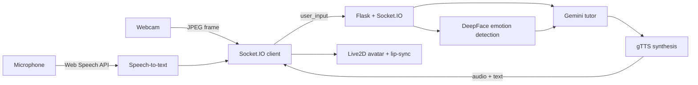

# AI Tutor

**An emotion-aware STEM tutor that listens, watches, and adapts to the student in real time.**

The assistant holds a spoken conversation, reads facial expressions through the webcam, and shapes its teaching style accordingly — while an animated Live2D avatar speaks the replies back with lip-syncing.


---

## Overview

Most tutoring bots only read text. This one also *sees* the learner. When a student looks confused, the tutor slows down and rephrases; when they look engaged, it goes deeper. The goal is a tutor that reacts the way a good human teacher does.

The pipeline is simple: the browser handles speech recognition and webcam capture, a Flask/Socket.IO backend runs emotion detection and the LLM, and the reply comes back as text plus synthesized speech that drives the avatar's mouth.

## How it works



1. **Capture** – the browser transcribes speech (Web Speech API) and grabs a webcam frame.
2. **Analyze** – the server reads the frame with DeepFace and classifies the dominant emotion.
3. **Respond** – Gemini generates a tutoring reply conditioned on the message, the emotion, and prior conversation.
4. **Speak** – the reply is converted to speech (cached by content hash) and streamed back to the client.
5. **Animate** – the Live2D model lip-syncs to the audio's amplitude while the text lands in the chat panel.

## Tech stack

| Layer | Tools |
|---|---|
| Backend | Flask, Flask-SocketIO, Eventlet |
| AI / LLM | Google Gemini or any OpenAI-compatible API (NVIDIA, Groq, OpenRouter, Ollama) |
| Vision | OpenCV, DeepFace, TensorFlow |
| Speech | Web Speech API (browser), gTTS (server) |
| Audio | pydub, FFmpeg |
| Frontend | Vanilla JS, PixiJS, Live2D Cubism |

## Prerequisites

- **Python 3.11** — required; TensorFlow/DeepFace do not yet support 3.13+
- **FFmpeg** on your `PATH` (used by pydub for audio conversion)
- An API key for a supported LLM provider (see [Choosing a language model](#choosing-a-language-model)) — a free key from [build.nvidia.com](https://build.nvidia.com) works
- A webcam and microphone
- Chrome or Edge recommended (Web Speech API support)

## Installation

```bash
git clone https://github.com/EngSenku/psy.git
cd psy
```

Create and activate a Python 3.11 virtual environment:

```bash
python3.11 -m venv venv
source venv/bin/activate        # Windows: venv\Scripts\activate
```

<details>
<summary>Using fish shell?</summary>

`activate` is a bash script, so fish can't source it. Use the fish variant, or
skip activation and call the interpreter directly:

```fish
source venv/bin/activate.fish
# or simply:
venv/bin/python controller.py
```

</details>

If your system Python is newer than 3.11, you can get 3.11 without touching
your system install using [uv](https://docs.astral.sh/uv/):

```bash
uv venv --python 3.11 venv
source venv/bin/activate
```

Install dependencies:

```bash
pip install -r requirements.txt
```

## Choosing a language model

The tutor can use Google Gemini **or any OpenAI-compatible API** (NVIDIA NIM, OpenAI, Groq, OpenRouter, Ollama, ...). Only the reply model changes — emotion detection and speech stay exactly the same.

> The examples below use bash `export`. On fish, use `set -x NAME "value"` instead.

**Gemini (default):**

```bash
export GEMINI_API_KEY="your_api_key_here"
```

**NVIDIA NIM** (OpenAI-compatible, defaults are already set for it):

```bash
export LLM_PROVIDER=openai
export OPENAI_API_KEY="nvapi-..."
```

Other OpenAI-compatible providers, by overriding the base URL and model:

```bash
# OpenAI
export LLM_PROVIDER=openai
export OPENAI_API_KEY="sk-..."
export OPENAI_BASE_URL="https://api.openai.com/v1"
export OPENAI_MODEL="gpt-4o-mini"

# Groq
export OPENAI_BASE_URL="https://api.groq.com/openai/v1"
export OPENAI_MODEL="llama-3.3-70b-versatile"

# Local Ollama (no key needed)
export OPENAI_BASE_URL="http://localhost:11434/v1"
export OPENAI_API_KEY="ollama"
export OPENAI_MODEL="llama3.1"
```

### Free models on NVIDIA

NVIDIA serves many models behind the same OpenAI-compatible endpoint. Choose one with `OPENAI_MODEL`:

| Model | `OPENAI_MODEL` value |
|---|---|
| Nemotron 3 Super *(default)* | `nvidia/nemotron-3-super-120b-a12b` |
| Nemotron 3 Ultra | `nvidia/nemotron-3-ultra-550b-a55b` |
| Nemotron Lightning *(fast)* | `nvidia/nemotron-3.5-lightning-30b-a3b` |
| Nemotron Nano | `nvidia/nemotron-nano-3-30b-a3b` |
| DeepSeek V4.1 | `deepseek-ai/deepseek-v4.1-flash` |
| GLM 5.3 | `z-ai/glm-5.3` |
| GLM 5.3 Flash | `z-ai/glm-5.3-flash` |
| Kimi K3 | `moonshotai/kimi-k3` |
| Kimi K2.6 | `moonshotai/kimi-k2.6` |
| GPT-OSS 20B | `openai/gpt-oss-20b` |
| Muse Glimmer | `meta/muse-glimmer-30b` |

To use Kimi instead, for instance:

```bash
export LLM_PROVIDER=openai
export OPENAI_API_KEY="nvapi-..."
export OPENAI_MODEL="moonshotai/kimi-k3"
```

Grab a free key and browse the full catalog at [build.nvidia.com](https://build.nvidia.com).

## Environment variables

| Variable | Default | Description |
|---|---|---|
| `LLM_PROVIDER` | `gemini` | `gemini` or `openai` (any OpenAI-compatible endpoint) |
| `GEMINI_API_KEY` | – | Gemini API key (required for the Gemini provider) |
| `GEMINI_MODEL` | `gemini-2.5-flash` | Gemini model used for replies |
| `OPENAI_API_KEY` | – | API key for the OpenAI-compatible provider |
| `OPENAI_BASE_URL` | `https://integrate.api.nvidia.com/v1` | Base URL for the OpenAI-compatible provider |
| `OPENAI_MODEL` | `nvidia/nemotron-3-super-120b-a12b` | Model used for the OpenAI-compatible provider |
| `MEMORY_FILE` | `chat_memory.json` | Path to the conversation history file |
| `MAX_MEMORY_TURNS` | `20` | Conversation turns kept in context |
| `TTS_CACHE_DIR` | `tts_cache` | Directory for cached speech files |

## Usage

```bash
python controller.py
```

Open **http://localhost:5000** and allow microphone and webcam access, then just start talking. Make sure the provider you chose above is configured (see [Choosing a language model](#choosing-a-language-model)).

> The first launch downloads the DeepFace emotion model (~6 MB). Browser speech recognition needs an internet connection.

## Project structure

```
psy/
├── controller.py       # Flask server, routes, and Socket.IO event handling
├── psychologist_ai.py  # LLM tutor (Gemini / OpenAI-compatible), memory, and TTS
├── emotion_module.py   # Webcam frame → emotion (DeepFace)
├── index.html          # Single-page frontend (UI, avatar, audio, socket client)
├── requirements.txt
├── haru/               # Live2D avatar model
├── static/             # Images and generated audio
├── tts_cache/          # Cached speech (generated)
└── ai/                 # Chat memory store (generated)
```

## Notes and limitations

- Emotion detection is only as good as the lighting — a clear, front-facing view works best.
- Browser speech recognition is cloud-based, so it needs a network connection.
- Speech is cached by a hash of the text, so repeated lines don't regenerate audio.
- Conversation state is stored as plain JSON on disk; there is no database.

## License

Released under the MIT License. Free to use for learning and experimentation.
